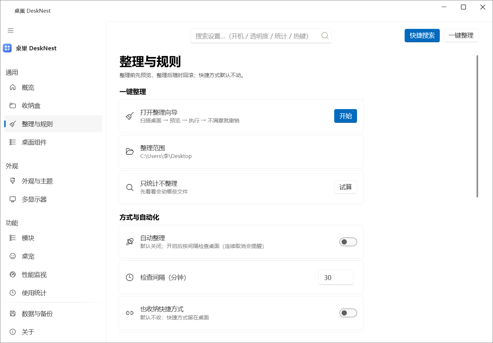
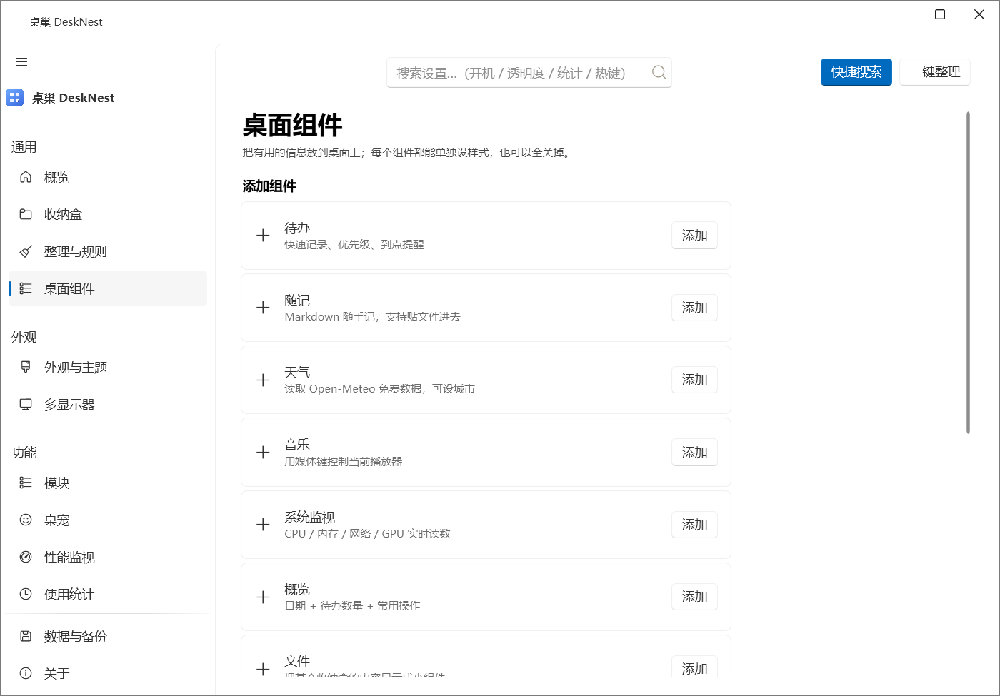
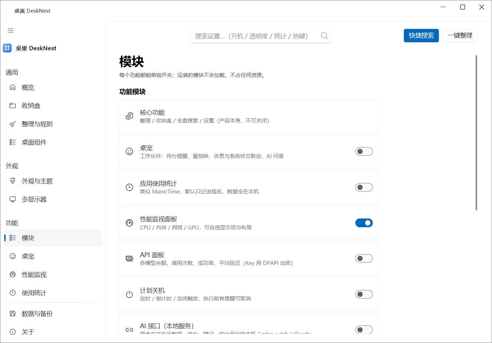
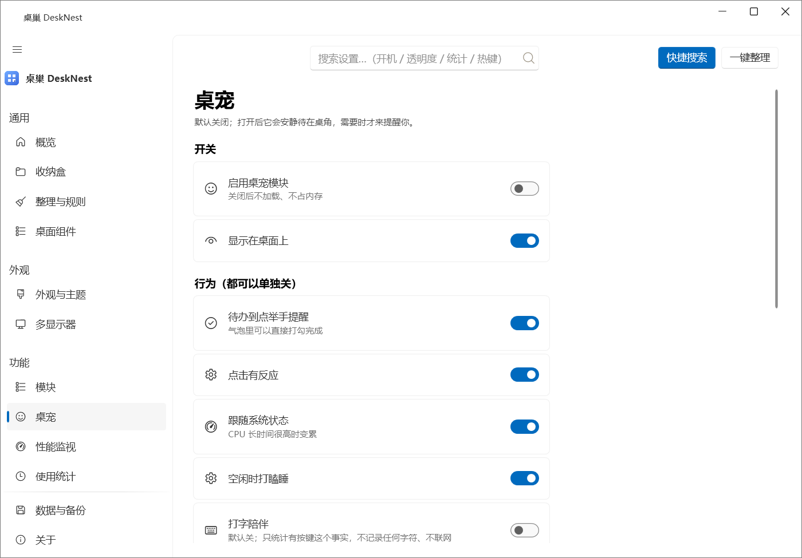
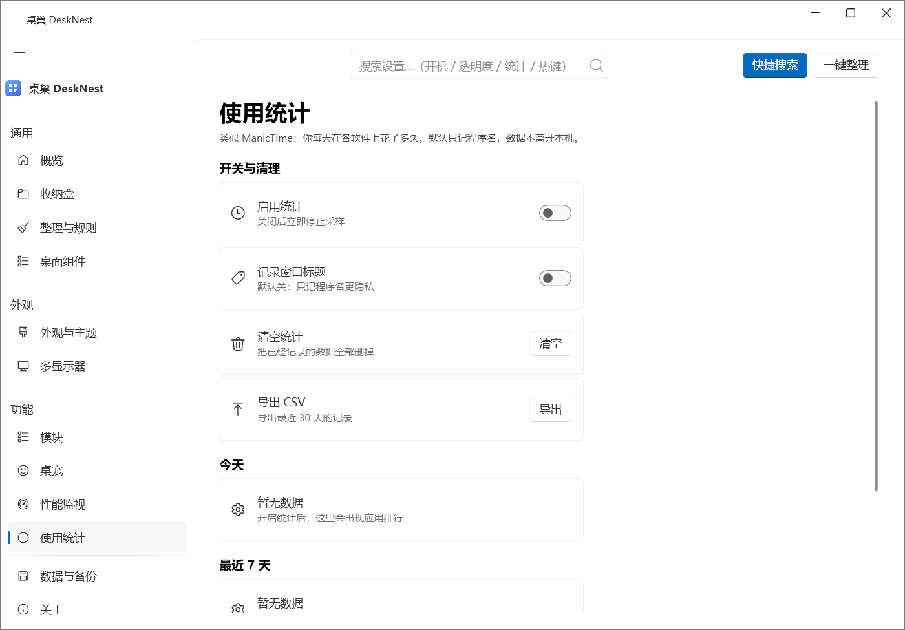
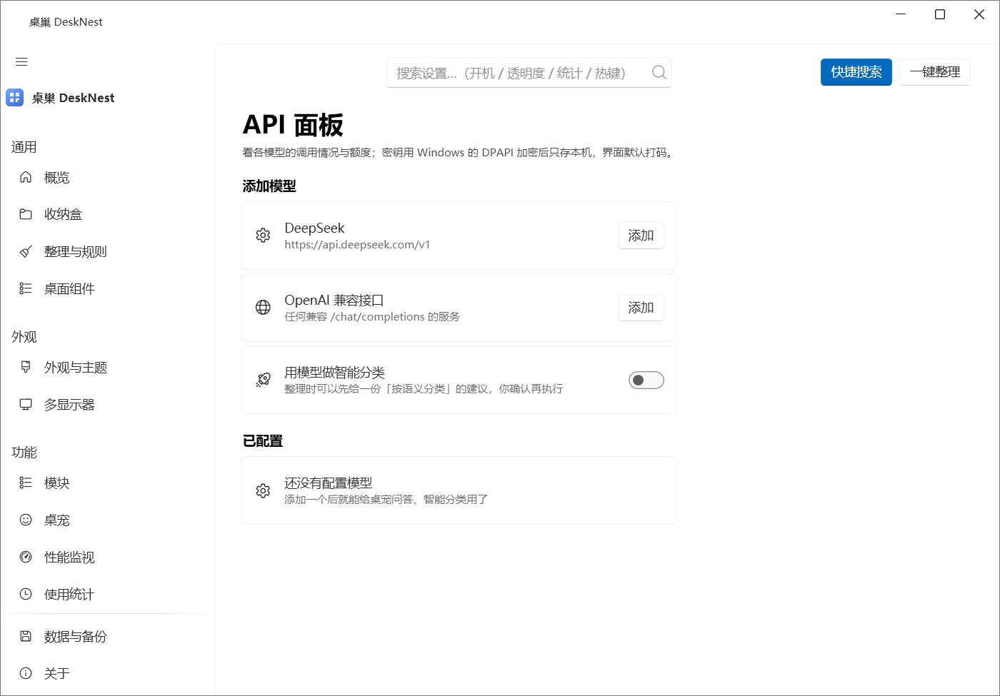
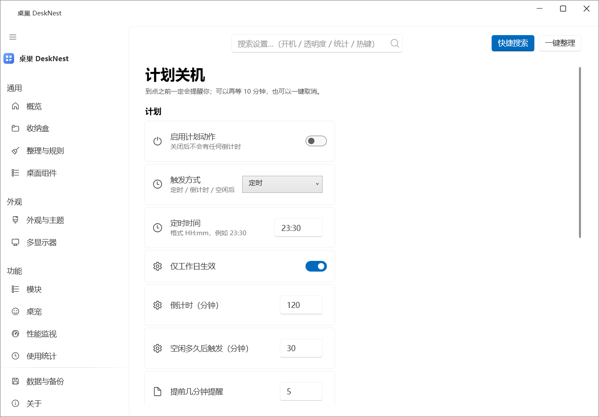
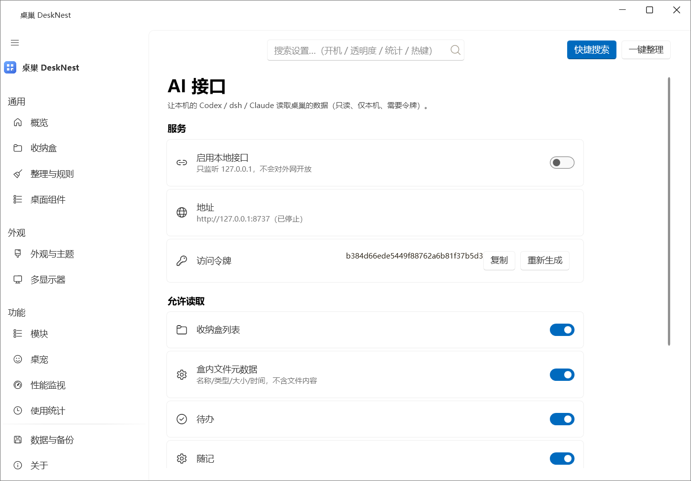
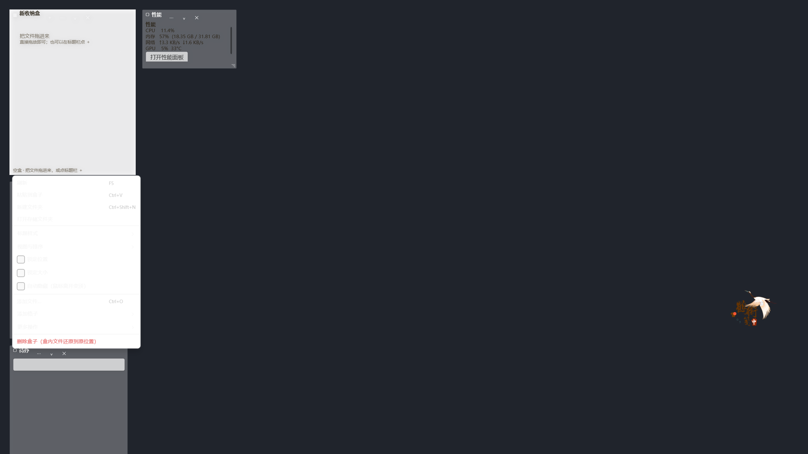
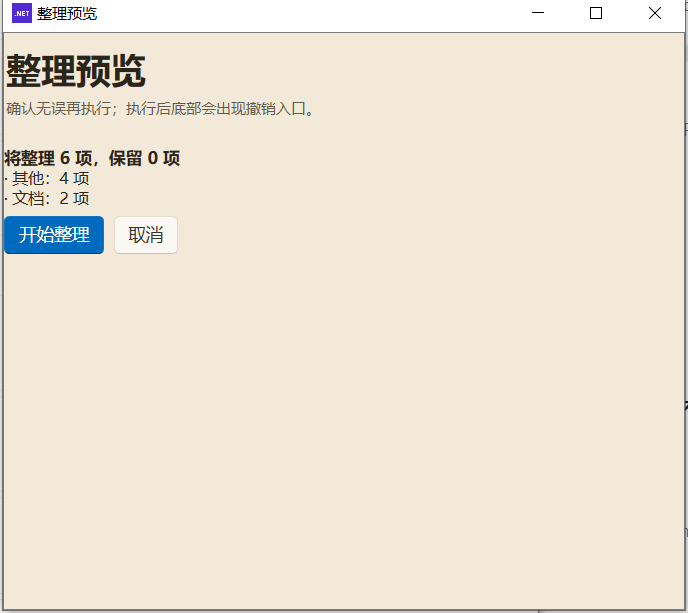

# 桌巢 DeskNest 完整软件方案书 v2.0

> 版本：v2.0 · 2026-10-15
> 对应代码：`desktop-organizer` 仓库 main 分支
> 界面截图：全部由图内 `DeskNest.exe --shot-pages <目录>` 自动生成（可复现，见第 9 章）
> 说明：v1.1 讲「要做什么」，v2.0 讲「现在实际是什么样」——每个界面都是真实跑出来的截图，不是效果图。

---

## 0. 一句话

桌巢是一个**桌面收纳 + 桌面组件 + 全盘搜索**的 Windows 桌面工具：把桌面文件收进桌面上悬浮的「收纳盒」，
盒子挂在壁纸之上、图标之下（不是盖在所有窗口上的悬浮层），鼠标点击自动置顶、点其他地方自动让位。
所有功能模块可单独开关、可卸载，不弹广告、不注册系统右键菜单、数据只留本机。

这一版（相对 v1.1）主要做了四件事：

1. **界面骨架换成真的 WinUI 式导航**（WPF-UI 的 NavigationView，带汉堡折叠），视觉与 DeskBox 同一路数。
2. **新增「多显示器」页**：屏幕示意图、每屏几个窗口、一键把盒子全搬到指定屏、防跑丢。
3. **右键菜单改成分级级联菜单**（标题样式 / 视图与排序 / 添加格子 / 更多操作），并补上「标题样式」四种形态。
4. **修了 6 个真实缺陷**（其中 3 个会丢数据或刷日志），测试从 57 项加到 **64 项全绿**。

---

## 1. 产品定位

| 项目 | 结论 |
| --- | --- |
| 给谁用 | 桌面文件常年堆到看不清壁纸的人；同时想要「桌面好看 + 找东西快」的人 |
| 核心差异 | 收纳盒**真的挂在桌面层**（不挡窗口、不抢焦点）；盒子行为可逐项精细控制；模块可全部关掉 |
| 不做 | 广告位、推广位、系统右键菜单注入、进程注入、上传用户数据、基础功能付费墙、壁纸库 |
| 收费 | 开源免费（MIT）；将来云同步作为可选的收费项，本地功能永久免费 |
| 技术底线 | 只在用户本机读写；联网功能（天气、API 面板）默认关闭，开启后可一键关闭 |

### 1.1 与其他软件的取舍

这是从三个商业软件 + 两个开源项目逐条比对后定下来的（逆向记录见 `docs/01-策划书-v0.1.md`）：

| 参考对象 | 学它什么 | 明确不学 |
| --- | --- | --- |
| DeskBox（开源，GPL-3.0） | 行式设置页的度量（64 高行、6 圆角、28 号页标题）、Fluent 图标、卡片分层 | 不用它的任何代码与美术资源（GPL 传染），只对齐「数值上的观感」 |
| 小智桌面 | 收纳盒 + 分区整理的产品思路 | 不在桌面右键菜单里塞一堆菜单项（用户明确要求） |
| 360 桌面 | 只做安装包静态逆向，看它怎么组织功能（**绝不安装**） | 一切弹窗、推荐、捆绑 |
| WitchDrawer（开源） | 抽屉式收纳的交互 | — |
| ZenDesktop（开源） | 桌面组件与信息密度 | — |
| 桌宠类开源项目 | 助手型桌宠的行为逻辑（待办提醒、番茄钟、状态联动） | 不做成只会卖萌的装饰品，默认关闭 |

---

## 2. 功能总览

### 2.1 已完成（本版可运行）

**桌面层**

- 四种收纳盒：普通盒（文件真的移进存储目录）、映射盒（只存路径）、抽屉盒、待办盒
- 盒子可拖动（Win32 原生移动循环）、四边 + 右下角缩放、卷起、自动隐藏、图标/列表视图
- **标题栏四种样式**：标准 / 紧凑 / 悬浮（鼠标移上去才显形）/ 隐藏（Alt+拖动移动）
- 盒组：多个盒子叠在同一位置，点标题栏标签或滚轮切换
- 盒子右键菜单：**分级级联结构**（见第 7 章）
- 六个桌面组件：待办、随记、天气、音乐、系统监视、概览

**整理**

- 两种形态：文件夹归集（真的建文件夹）/ 桌面分区（收进盒子，桌面不留文件夹）
- 预览向导：先算清楚将整理几项、保留几项，再执行；执行后可整体回滚
- 规则整理（按扩展名 / 关键词 / 大小 / 时间）+ 自动整理（默认关，可暂停 1 小时）

**搜索**

- `Alt+Space` 全局快捷搜索：文件、应用、命令（`/` 前缀）
- 默认索引所有固定磁盘；索引落盘到 SQLite，重启不必重扫
- 实测单机 326 万条；写入有「不许用残缺索引覆盖完整索引」的保护（见 10.2）

**可选模块（6 个独立 dll，未安装则不加载、不占内存、界面不出现）**

| 模块 | 能做到什么 |
| --- | --- |
| 桌宠 | 助手型：待办到点举手提醒、番茄钟、久坐提醒、CPU 过高变「累」；`.petpack` 素材包；打字陪伴默认关 |
| 使用统计 | 类似 ManicTime，记录各应用使用时长（默认只记进程名） |
| 性能监视 | CPU / 内存 / 网络 / GPU，显示项与排布可自选 |
| API 面板 | 各模型 API 余额、调用次数、成功率、平均延迟；Key 用 DPAPI 加密 |
| 计划关机 | 定时 / 倒计时 / 空闲触发；执行前弹窗提醒，可取消 |
| AI 接口 | 只读本地服务，把盒内文件元数据、待办、随记、统计开放给本机 Codex / dsh / Claude |

**外壳**

- 托盘、开机自启、单实例、本地自动备份、数据目录迁移、诊断包导出
- **两套独立外观**：设计窗口（主窗口/设置页）与收纳窗口（桌面盒/组件/桌宠）各调各的，可互相复制
- 主题：跟随系统 / 深色 / 浅色 / 纯黑 / 护眼；材质：亚克力 / Mica / 纯色；透明度与圆角可调

### 2.2 本轮新增

- 真 NavigationView 导航（汉堡折叠成图标栏、分组标题、「维护」组移到页脚）
- 「多显示器」页
- 分级右键菜单 + 标题栏四种样式 + Alt 拖动 + `Shift+F10` 键盘开菜单
- 盒子重命名、透明度/圆角快捷子菜单、把某个盒子并进当前盒组
- 「数据与备份」页新增**压缩数据库**
- **文档截图模式**：`DeskNest.exe --shot-pages <目录>`，一条命令生成全部界面截图

### 2.3 规划中（未做）

- 云同步（可选收费项）
- 设置页二级下钻 + 面包屑（现在是一级平铺，靠分组）
- 桌面层的「胶囊模式」（盒子收成一条细条）
- 更多桌宠素材包与社区分享

---

## 3. 信息架构

主窗口左侧导航分四组，共 **15 个页面**（模块没装的页面会直接不出现）：

```
桌巢 DeskNest
├─ 通用
│   ├─ 概览            桌面状态 + 常用操作入口
│   ├─ 收纳盒          新建 / 管理收纳盒、单独调样式
│   ├─ 整理与规则      一键整理、规则、自动整理
│   └─ 桌面组件        待办 / 随记 / 天气 / 音乐 / 系统监视 / 概览
├─ 外观
│   ├─ 外观与主题      设计窗口与收纳窗口两套外观
│   └─ 多显示器        屏幕布局、搬运窗口、防跑丢
├─ 功能
│   ├─ 模块            每个模块单独开关 + 性能与隐私
│   ├─ 桌宠
│   ├─ 性能监视
│   ├─ 使用统计
│   ├─ API 面板
│   ├─ 计划关机
│   └─ AI 接口
└─ 维护（导航页脚）
    ├─ 数据与备份
    └─ 关于
```

桌面层（不占导航）：

```
收纳盒 / 桌面组件 / 桌宠
├─ 左键拖动标题栏      移动（隐藏标题栏时：Alt + 拖动任意处）
├─ 拖动四边或右下角    缩放
├─ 双击标题栏          卷起 / 展开
├─ 右键任意处          打开盒子菜单（分级，见第 7 章）
├─ Shift+F10 / 菜单键  键盘打开同一套菜单
├─ 滚轮                组内切换盒子；按住 Ctrl 滚动 = 改图标大小
└─ 拖入文件            放进盒子（移动，不是复制）
```

---

## 4. UI 设计规范

### 4.1 设计令牌（`Ui/DesignTokens.cs`）

| 类别 | 取值 | 依据 |
| --- | --- | --- |
| 间距栅格 | 4 / 6 / 8 / 12 / 16 / 20 / 24 / 28 / 32 | Fluent 4px 网格 |
| 圆角 | 卡片 6 · 控件 6 · 小组件 8/12/16 | 对齐 DeskBox 的 6 圆角 |
| 设置行 | 最小高 64 · 内边距 16/10 · 图标与文字间距 20 | DeskBox 设置页度量 |
| 按钮 | 高 34 · 最小宽 104 · 圆角 6 | Fluent 规范 |
| 图标 | 行内 20 / 导航 18 | Segoe Fluent Icons |
| 字号 | 页标题 28 · 小节 15 · 设置项 14 · 正文 13 · 说明 12 · 小字 11 | |
| 内容列宽 | 最大 840 且左对齐 | 宽屏下不把行内控件拉到屏幕另一头 |

### 4.2 两套外观互相独立

这是用户明确要求的一条，也是和 DeskBox 的差别：**设计窗口**（主窗口、设置页、通知）与
**收纳窗口**（桌面盒、组件、桌宠）各有一套配色 / 材质 / 强度 / 透明度 / 圆角，互不影响；
「外观与主题」页提供两个方向的「复制」，也可以一键让所有盒子统一成收纳窗口那套。

### 4.3 可读性硬指标

- 正文对比度 ≥ 4.5:1，次要文字 ≥ 3:1；四套配色下都有回归测试（`ThemeContrastTests`）
- 明暗判定由**配色方案**决定，不按时间猜（护眼配色在夜里曾被判成深色 → 深底深字看不清）
- 次要文字用「与背景混合后的实色」，不用「前景色 + 透明度」（透明度叠在不同表面上会糊）
- 点击热区 ≥ 34px；动效 ≤ 320ms；提供「减少动效」开关

### 4.4 图标

图标全走矢量（`SymbolIcon` + `SymbolRegular`，WPF-UI 自带，MIT），不依赖图像素材。
语义键 → 图标的映射集中在 `Ui/Icons.cs`，并且**码位与图标名之间必须显式翻译**：
v1.0.1 曾出现「导航里每一项都是同一个齿轮」，根因就是导航传的是 MDL2 码位，
而映射表只认 emoji / 语义键，全部落进默认值。现在有 `IconMapTests` 钉住这件事。

---

## 5. 界面逐页说明（真实运行截图）

> 截图由 `DeskNest.exe --shot-pages` 自动生成：固定 1120×780 窗口、逐个打开页面、抓图后退出。
> 同一版软件的截图永远长得一样，发版时可以直接贴进文档。

### 5.1 概览


- 顶部：设置搜索框（输入「统计/性能/关机」会跳到对应页）、快捷搜索、一键整理
- 左栏：四组导航；当前页高亮，左侧有强调色短竖条
- 主体：桌面状态三张卡（收纳盒数量、组件数量、搜索索引条数）+ 常用操作入口

### 5.2 收纳盒


- 新建两种形态：「文件夹归集」和「桌面分区（推荐）」
- 已有盒子列表：点开可单独调这个盒子的材质、透明度、圆角、图标大小

### 5.3 整理与规则



- 「一键整理」打开预览向导；「只统计不整理」先试算
- 下方是规则列表（按类型 / 关键词 / 大小 / 时间）与自动整理开关

### 5.4 桌面组件



- 六类组件：待办、随记、天气、音乐、系统监视、概览
- 每类可加多个；位置、大小、透明度独立保存

### 5.5 外观与主题


- 上：设计窗口（配色 / 材质 / 材质强度 / 透明度 / 圆角）
- 中：收纳窗口（同一组控件，独立生效）
- 下：两个方向的复制、统一或独立、减少动效、给盒子加背景图

### 5.6 多显示器（本版新增）


- 屏幕示意图按真实相对位置缩放绘制，主屏有强调色描边与编号
- 每块屏一行：设备名、分辨率、工作区、**当前这块屏上有几个窗口**
- 「全部移到此屏」把可见盒子与组件整齐排到目标屏；「是这块屏？测试」让目标屏闪一下
- 防丢开关：新建盒子放在鼠标所在屏；启动时把跑出屏幕的窗口拉回来（可关）

### 5.7 模块



- 每个可选模块一行开关；未安装的模块直接写明「未安装」
- 「性能与隐私」：隐藏后清理缓存、空闲修剪工作集、记录搜索历史、索引范围、重建索引

### 5.8 数据与备份


- 数据目录与日志入口、备份保留份数、退出时自动备份、立即备份、备份列表（可回滚）
- 诊断包导出（只含日志 / 设置 / 环境信息，不含文件内容）
- **压缩数据库**（本版新增）：全盘索引是整表重写，会留下大量空闲页；实测数据库曾涨到 1.6 GB

### 5.9 关于


- 版本、开源许可、第三方组件（WPF-UI 等）、本地数据位置

### 5.10 桌宠



- 默认关闭；打开后可设形象、缩放、透明度、置顶方式
- 行为开关：待办提醒、番茄钟、久坐、点击反应、系统状态联动
- 打字陪伴默认关，且只统计「有没有按键」，不记录字符

### 5.11 性能监视


- CPU / 内存 / 网络 / GPU 各自可显示或隐藏，布局可选
- 顶部说明它也能做成桌面组件常驻

### 5.12 使用统计



- 各应用使用时长排行（默认只记进程名，不含窗口标题）
- 数据全在本机，可清空

### 5.13 API 面板



- 各服务商：调用次数、成功率、平均延迟、余额与告警线
- Key 用 Windows DPAPI 加密存储，不落明文

### 5.14 计划关机



- 定时 / 倒计时 / 空闲三种触发；关机、重启、睡眠三种动作
- 执行前按设定分钟数弹窗提醒，期间有活动会自动顺延（可关）

### 5.15 AI 接口



- 只读本地服务（默认 `127.0.0.1:8737`），供本机 Codex / dsh / Claude 读取
- 逐项授权：盒子、条目、待办、随记、统计各自可开可关；带访问令牌
- 只读、不改文件、不外发

### 5.16 桌面层（收纳盒 + 组件）


- 盒子挂在壁纸之上、图标之下；点它才置顶，点别的窗口它自动让位
- 这张图里两个盒子是用户把「收纳窗口」透明度调到 0.3 的实际效果

### 5.17 盒子右键菜单（分级）



### 5.18 展开二级菜单


菜单的完整结构见第 7 章。

### 5.19 快捷搜索面板（Alt+Space）

> 这一页不放截图：搜索面板是浮在桌面上的独立窗口，截图会连带把当时桌面上别的内容一起拍进去。
> 想看效果直接按 `Alt+Space`。

- 输入即搜，`↑↓` 选择、`Enter` 打开、`Ctrl+Enter` 打开所在位置、`Esc` 关闭
- 输入 `/` 进入命令模式（整理桌面、新建盒子、隐藏桌面图标、显示/隐藏桌面层…）

### 5.20 一键整理向导



- 先列出「将整理 N 项、保留 M 项」，按分类汇总
- 「开始整理」执行，执行后底部出现撤销入口

---

## 6. 桌面层交互规格（鼠标动作逐层）

> 完整版见 `docs/08-桌面交互规格与鼠标测试清单.md`，这里是本轮更新后的要点。

### 6.1 盒子上的鼠标动作

| 动作 | 结果 |
| --- | --- |
| 左键单击盒子 | 盒子激活并置顶；点其他程序时它自动回到桌面层（不抢焦点） |
| 按住标题栏拖动 | 移动盒子（Win32 原生移动循环，多显示器 / DPI 都不用手算） |
| 隐藏标题栏后 Alt + 拖动任意处 | 移动盒子 |
| 拖四边 / 右下角 | 缩放（遵守最小 160×96 与「锁定尺寸」） |
| 双击标题栏 | 卷起 / 展开 |
| 右键任意处 | 打开盒子菜单 |
| `Shift+F10` 或键盘菜单键 | 键盘打开盒子菜单（不用鼠标也能改设置） |
| 滚轮 | 在盒组内切换盒子 |
| `Ctrl` + 滚轮 | 改图标大小 |
| 拖文件进盒子 | 移进盒子（移动，原位置不再有；「从盒中移除」会还原回原位置） |
| 拖到屏幕边缘外 | 允许（多屏常见需求），但启动时会检查「是否跑出所有屏幕」 |

### 6.2 拖动与缩放的可靠性

- 拖动：`WindowMove.BeginDrag` 走系统原生移动循环；失败时才退回「自己算增量」
- 缩放：`ComputeResize` 是纯函数（四边 + 右下角 + 最小尺寸），有单元测试
- 落盘限流：拖动 / 缩放最多每 250ms 写一次数据库，结束后强制补写一次

---

## 7. 盒子右键菜单（分级结构）

参考 DeskBox 的菜单组织方式：常用动作在最上面平铺，需要多选或需要二次确认的收进二级菜单，
危险操作沉底并标红。每一项都有勾选态（表示当前状态）与快捷键提示。

```
刷新                                      F5
粘贴到盒子                                Ctrl+V      ← 剪贴板里没有文件时置灰
新建文件夹                                Ctrl+Shift+N
打开存储文件夹
─────────────────────────────
标题样式                              ▸   标准
                                          紧凑
                                          悬浮（鼠标移上去才显形）   ← 盒组内禁用并说明原因
                                          隐藏（Alt+拖动移动盒子）   ← 盒组内禁用并说明原因
视图与排序                            ▸   图标视图 / 列表视图
                                          排序方式 ▸  名称 / 加入时间 / 大小
                                          升序 / 降序
                                          图标大小 ▸  小(20) / 中(30) / 大(44) / 特大(60)
                                          显示文件名
                                          显示扩展名
锁定位置                                    ← 勾选态代表当前已锁定
锁定大小
自动隐藏（鼠标离开变淡）
─────────────────────────────
添加文件…                                 Ctrl+O
添加格子                              ▸   新建收纳盒…
                                          并入本组 ▸   ＋ 盒子A / ＋ 盒子B …
更多操作                              ▸   单独设置样式（不再跟随全局）
                                          把当前外观应用到所有盒
                                          卷起 / 展开
                                          重命名盒子…
                                          透明度 ▸  30% / 50% / 70% / 85% / 100%
                                          圆角   ▸  直角(0) / 小(6) / 中(12) / 大(18) / 胶囊(24)
─────────────────────────────
删除盒子（盒内文件还原到原位置）                    ← 红色
```

盒内单个文件的右键菜单同样分级：

```
打开
打开方式…                                              ← 文件夹置灰
在资源管理器中显示
复制                                  ▸   复制完整路径 / 复制文件名
─────────────────────────────
固定到顶部
移动到其他盒子                        ▸   盒子A / 盒子B / …
重命名…
─────────────────────────────
从盒中移除（文件还原到原位置）                          ← 红色
```

设计上的三条规矩：

1. **不留死按钮**：任何一项要么能点，要么明确置灰并给出原因（如「格子组需要持续可见的标题栏」）。
2. **勾选态代表现状**：`锁定位置` 打勾 = 现在已锁定，而不是「点了会锁定」。
3. **危险操作单独放最后并标红**，删除盒子前会弹确认框说明文件去哪。

---

## 8. 技术架构

```
DeskNest.App        WPF 界面层：主窗口（FluentWindow + NavigationView）、桌面盒、组件、桌宠、托盘、热键
DeskNest.Core       业务逻辑：数据模型 / SQLite 仓储 / 整理引擎 / 搜索 / 备份 / 模块宿主
DeskNest.Native     Win32 原生：桌面层挂载、原生拖动、DWM 效果、显示器、热键、电源、DPAPI
DeskNest.Module.*   6 个可选模块，编译成独立 dll，未放进 modules\ 就等于「没安装」
```

- 运行时：**.NET 10 + WPF**，自包含发布（用户机器不需要装 .NET）
- 界面库：**WPF-UI（lepoco，MIT，4.3.0）**——FluentWindow、NavigationView、CardControl、
  ToggleSwitch、InfoBar、SymbolIcon、TitleBar
- 数据：SQLite（WAL），单文件 `%LOCALAPPDATA%\DeskNest\desknest.db`
- 桌面层：`SetParent` 到 Explorer 的 `WorkerW`（壁纸之上、图标之下）；**不注入、不挂钩系统进程**
- 键盘跟随、热键走 `RegisterHotKey` / 低级钩子，只在用户开启时启用

### 8.1 为什么「盒子挂在桌面层」很关键

普通「悬浮窗」要么永远盖在别人上面（挡窗口），要么被别的窗口盖住就看不见。
挂到 `WorkerW` 之后，盒子在系统眼里跟桌面图标是一层：任何窗口都能正常盖住它，
点它才临时置顶；点别处它自动回去。这就是「桌面上有盒子」和「桌面上飘了个窗」的区别。

### 8.2 两级样式

盒子的外观 = 收纳窗口全局令牌 → 叠加单个盒子的覆盖值（材质 / 强度 / 透明度 / 圆角）。
新建时默认「跟随全局」，一旦在某处单独调整，就自动切成「独立」（用户不会觉得「调了没反应」）。

---

## 9. 构建与发布

```powershell
# 本机 .NET 10 SDK 装在私有目录，不污染系统
$env:DOTNET_CLI_HOME="C:\Users\李\Desktop\项目组\.dotnet-home"
$env:NUGET_PACKAGES="C:\Users\李\Desktop\项目组\.nuget"
$dn="C:\Users\李\.dotnet-sdk\dotnet.exe"
cd desktop-organizer

& $dn build   DeskNest.slnx
& $dn test    tests\DeskNest.Tests\DeskNest.Tests.csproj      # 必须在沙箱外跑（要写桌面/建窗口）
& $dn publish src\DeskNest.App\DeskNest.App.csproj -c Release -r win-x64 --self-contained true -o dist\DeskNest-1.1.0
```

发布产物：`dist\DeskNest-1.1.0\`（自包含）+ `modules\`（6 个可选模块）。

### 9.1 生成界面截图（本版新增）

```powershell
.\dist\DeskNest-1.1.0\DeskNest.exe --shot-pages C:\path\to\out
```

它会：固定窗口尺寸 → 逐个打开每个设置页抓图 → 收起主窗口、铺一层真实壁纸当底、
把桌面层窗口临时置顶，拍桌面层与右键菜单（含展开的二级菜单）→ 打开搜索面板与整理向导各拍一张 → 退出。
截图期间会先把盒子整齐排到主屏、拍完按快照还原用户的摆放，**不改变用户桌面**。

---

## 10. 质量与测试

### 10.1 自动化测试：**64 项，全绿**

| 测试文件 | 覆盖 |
| --- | --- |
| `FileOpsTests` | 移动进存储、重名 `(1)`、还原回原位置、原位置缺失回退桌面 |
| `OrganizeTests` | 扫描 / 预览计划、文件夹与分区两种形态、回滚 |
| `RulesEngineTests` | 扩展名 / 关键词 / 大小 / 时间条件与优先级 |
| `BehaviourTests` | 盒子 / 组件 / 盒组的持久化与两级样式合成 |
| `ThemeContrastTests` | 四套配色的对比度（正文 ≥ 4.5:1、次要 ≥ 3:1） |
| `WindowDragTests` | 四边缩放与最小尺寸的纯函数计算 |
| `IconMapTests` | 导航图标必须各自不同（防止「全是齿轮」回归） |
| `SearchIndexStoreTests` | 索引落盘往返、空集合不清表、并发保存不嵌套事务 |
| `UiSmokeTests` | STA 线程里建主窗口，**逐个打开每个设置页**，任何一页构建抛异常都算失败 |

### 10.2 本轮修掉的真实缺陷（都有日志或截图证据 + 回归测试）

| # | 现象 | 根因 | 处理 |
| --- | --- | --- | --- |
| 1 | 左侧导航每一项都是同一个齿轮图标 | 导航传的是 MDL2 码位，而图标映射表只认 emoji / 语义键，全部落进默认值 | 补「码位 → Fluent 图标名」翻译表；加 `IconMapTests` 钉住 |
| 2 | 日志每秒刷「性能采样异常：调用线程无法访问此对象」 | 采样在后台计时器线程上直接触发订阅者（界面元素） | 采样器记下启动时的同步上下文，把事件送回 UI 线程；单个订阅者异常不再拖垮采样链 |
| 3 | 退出时「保存搜索索引失败：cannot start a transaction within a transaction」 | BEGIN / COMMIT 是跨语句的，两个线程同时保存会互相插队 | 落盘加串行闸门；DELETE 移进事务内（避免中途失败留下空表） |
| 4 | 退出时「Cannot access a disposed object」 | 索引线程还在写盘，主流程已经释放数据库连接 | 退出时等索引线程收工（最多 20 秒）；没收工就跳过数据库释放，交给进程退出统一回收 |
| 5 | **326 万条搜索索引被 28 万条覆盖** | 扫描被中途取消，仍把「半份索引」整表写回 | 新增保护：扫描未完成且结果比库里少时拒绝落盘；空集合绝不写库 |
| 6 | 数据库文件涨到 1.6 GB | 索引是整表重写，SQLite 不主动归还空闲页 | 落盘后回收 WAL；新增「压缩数据库」按钮（VACUUM）；新库启用增量自动回收 |

另外两处交互修正：

- 截图模式用模态方式打开「整理向导」导致进程卡死 → 改为可非模态打开，并加 4 分钟超时兜底。
- 桌面层窗口永远在别的窗口之下，截图 / 演示时看不见 → 截图模式临时「摘下来」置顶、拍完装回去。

### 10.3 手工回归（每次发版走一遍）

见 `docs/smoke-checklist.md`：新建盒子 → 拖文件进出 → 拖动 / 缩放 / 卷起 → 组切换 → 一键整理并撤销 →
`Alt+Space` 搜索 → 改两套外观 → 开关模块 → 备份与回滚。

---

## 11. 风险与合规

| 风险 | 应对 |
| --- | --- |
| 收纳 = 真的搬动用户文件 | 整理前有预览；执行后可整体回滚；删除盒中条目会还原到原位置；原位置不存在则回退桌面 |
| 挂 WorkerW 是否算「侵入系统」 | 只用公开的 `SetParent` + 系统消息，不注入、不挂钩、不改注册表；失败时降级为普通置顶窗口 |
| 网络投诉面 | 天气与 API 面板默认关闭；AI 接口只监听 `127.0.0.1` 且只读；诊断包不含文件内容 |
| 许可证 | 本项目 MIT；WPF-UI 等第三方许可见 `THIRD-PARTY-NOTICES.md`；DeskBox 只参考设计度量，不用其代码与素材 |
| 索引占用磁盘 | 提供索引范围设置、重建索引、压缩数据库；索引只存路径 / 大小 / 时间，不读文件内容 |

---

## 12. 下一步（建议顺序）

1. 把搜索索引的一次完整扫描跑完，然后压缩一次数据库（当前库里是 34 万条的中间态，完整应为 300 万量级）。
2. 设置页二级下钻 + 面包屑（现在 15 页平铺，模块多了会显得长）。
3. 桌面层「胶囊模式」（盒子收成一条细条，桌面更干净）。
4. 云同步（可选收费项）：先做「导出 / 导入一份加密快照」，再做账号与合并。
5. 桌宠素材包与桌面组件模板的社区分享格式（`.petpack` 已有基础）。

---

_本方案书由 `DeskNest.exe --shot-pages` 生成的真实截图驱动，图与代码同版本。_
