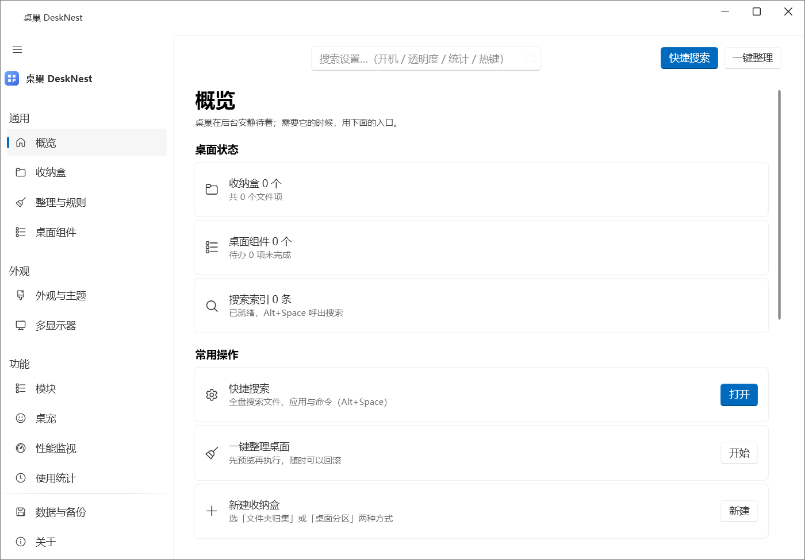
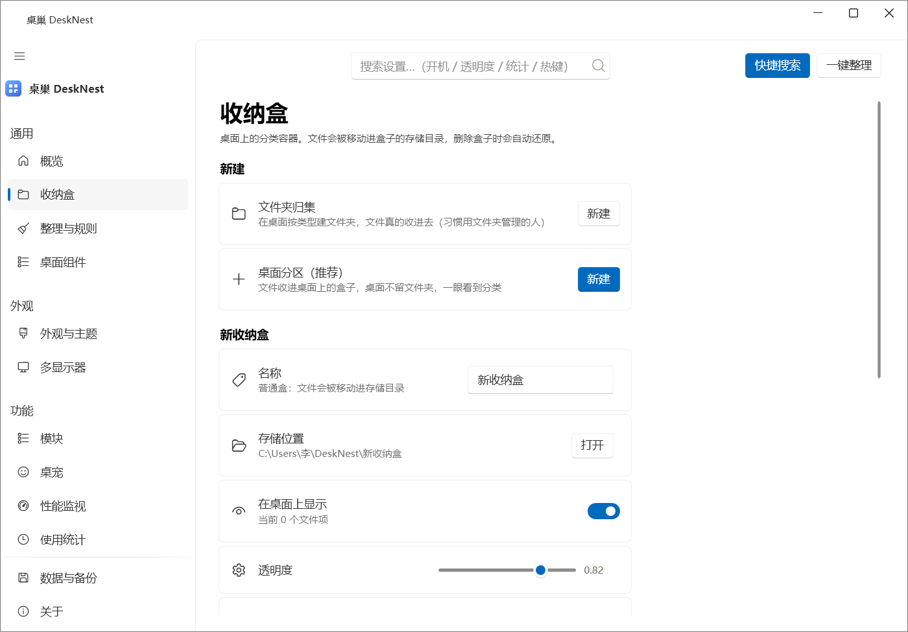
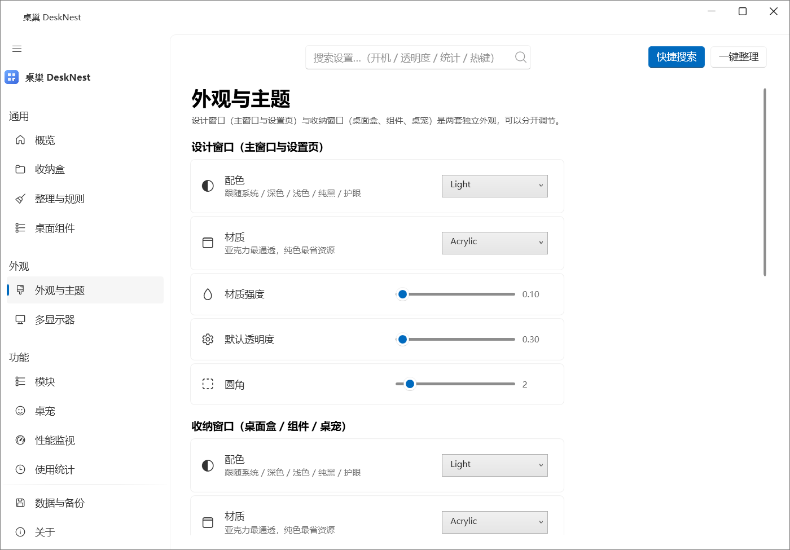
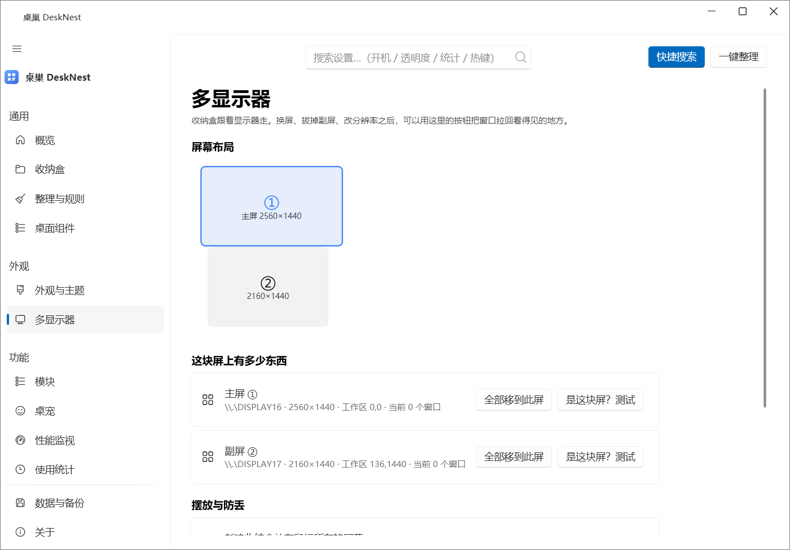
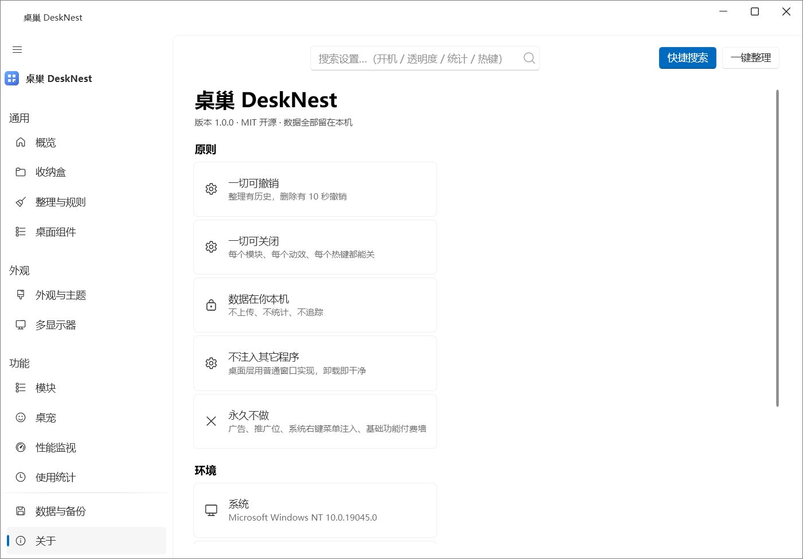
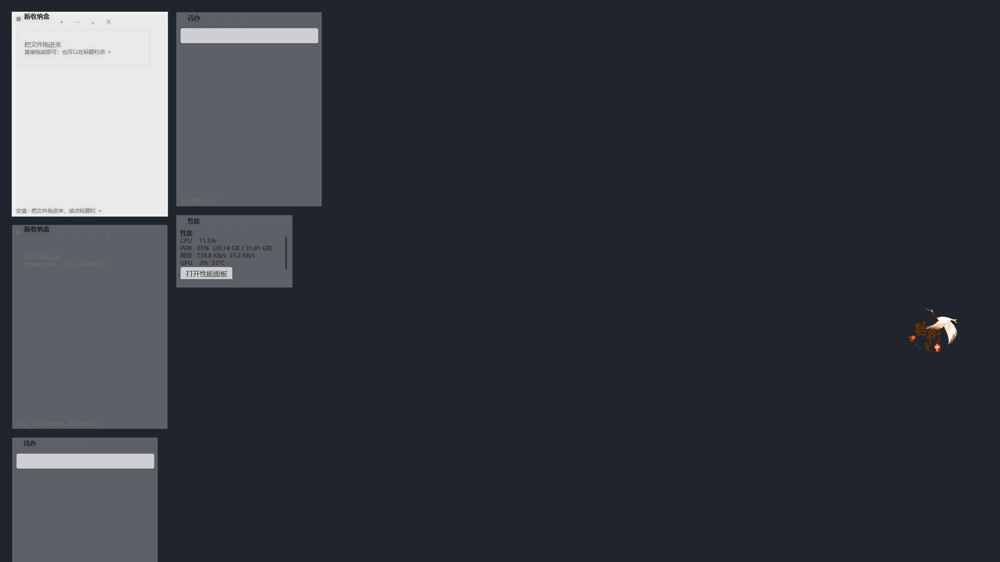
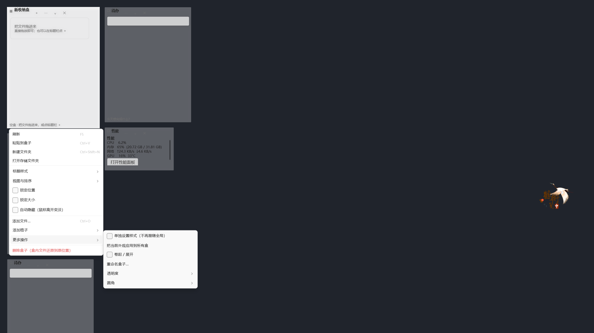
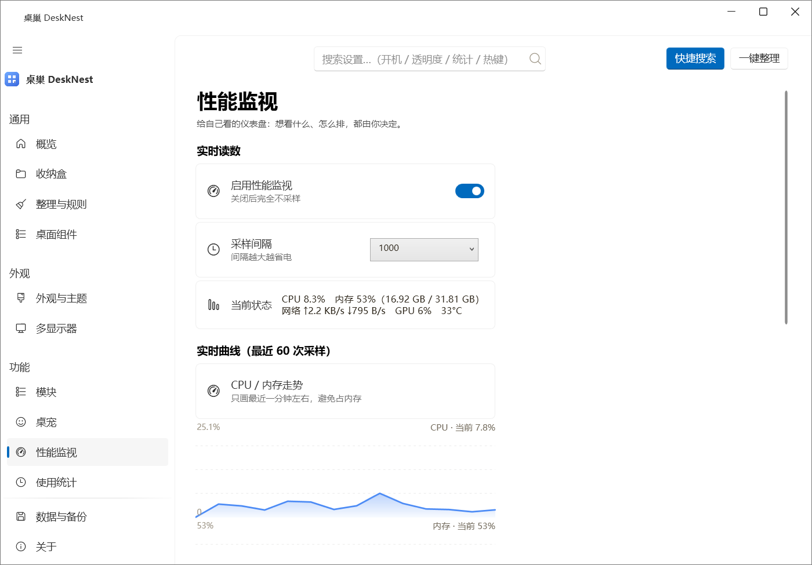

# 桌巢 DeskNest · 完整软件策划书

> 版本：v1.1（2026-10-15） · 对应代码：`main` 分支 · 许可：MIT
> 配套文档：`docs/08-桌面交互规格与鼠标测试清单.md`（交互细节）、`docs/09-桌巢-完整软件方案书-v2.0.md`（逐页截图版）
> 本文是**一份能从头读到尾的策划书**：做什么、给谁做、怎么设计、怎么做出来、怎么测、怎么发、下一步做什么。

---

## 一、一页总结

| 问题 | 答案 |
| --- | --- |
| 这是什么 | Windows 上的_桌面收纳 + 桌面组件 + 全盘搜索_工具 |
| 解决什么痛点 | 桌面文件堆满、找不到东西、想好看又不想装一堆带广告的软件 |
| 最大差异 | 收纳盒**真的挂在桌面层**（壁纸之上、图标之下），不挡窗口、不抢焦点；每个功能都能单独关掉 |
| 现在到哪一步 | v1.1 可跑：15 个设置页、6 个可选模块、**85 项自动化测试全绿**；已开源并推送 GitHub |
| 谁在用 | 目前是作者本人单机自用（i5-13600KF / 32G / RTX 4060Ti），按"自己天天用"的标准做 |
| 下一步 | 跑完一次完整索引并压缩数据库 → 设置页二级下钻 → 胶囊模式 → 可选云同步 |

主界面（概览页，真实运行截图）：



---

## 二、用户与使用场景

### 2.1 目标用户

1. **主力用户（就是作者）**：单休上班族，桌面常年堆着下载文件、截图、工程目录；想要"桌面干净 + 找东西快 + 不要广告"。
2. **同类用户**：用过 360 桌面 / 小智桌面 / DeskBox，被弹窗、推荐位、系统右键菜单注入劝退的人。
3. **进阶用户**：愿意折腾样式（两套外观、每盒独立样式），也愿意接 AI（本地只读接口）。

### 2.2 典型场景

| 场景 | 现在的做法 | 桌巢的做法 |
| --- | --- | --- |
| 桌面文件堆满 | 手动归类到文件夹，桌面留一堆文件夹 | 收进桌面上的收纳盒，桌面不留文件夹 |
| 找文件 | 翻资源管理器 | `Alt+Space` 输入关键字，或直接看盒子里的图标 |
| 想要待办/天气/性能 | 装三四个小组件软件 | 桌面组件模块，可单独开关 |
| 想记录电脑用了多久 | 装 ManicTime | 使用统计模块（默认只记进程名） |
| 让 AI 读本机资料 | 手动复制粘贴 | 本地只读接口，Codex / dsh / Claude 直接读盒内清单 |

---

## 三、竞品与逆向结论

### 3.1 我们逆向过什么

用 REA 技能对手上的安装包与开源项目做静态分析（**只读安装包，绝不安装**）：

- **DeskBox（开源，GPL-3.0）**：设置页度量、卡片分层、Fluent 图标用法
- **小智桌面**：收纳盒 + 分区整理的产品结构
- **360 桌面安装包**：只做静态结构分析；**明确不安装**（广告与捆绑太多），也**不学它的任何推广逻辑**
- **WitchDrawer / ZenDesktop（开源）**：抽屉收纳与组件信息密度
- **桌宠类开源项目**：助手型桌宠的行为设计

### 3.2 学什么、不学什么

| 对象 | 学 | 不学 |
| --- | --- | --- |
| DeskBox | 行高 64 / 圆角 6 / 页标题 28 这些"观感数值" | 不用它的代码与素材（GPL 传染），只对齐数值 |
| 小智桌面 | 收纳盒 + 分区整理 | 不在系统右键菜单里加一堆菜单项 |
| 360 桌面 | 只用来了解功能面 | 弹窗、推荐、捆绑、越权 |

---

## 四、功能规划

### 4.1 已完成（v1.1 可运行）

**桌面层**

- 四种收纳盒：普通盒、映射盒、抽屉盒、待办盒
- 拖动（原生移动循环）、四边/右下角缩放、卷起、自动隐藏、图标/列表视图
- 标题栏四态：标准 / 紧凑 / 悬浮 / 隐藏（隐藏后 `Alt+拖动` 移动）
- 盒组：多盒叠一处，标题栏标签或滚轮切换
- 分级右键菜单（详见第六节）

**整理**

- 文件夹归集 / 桌面分区两种形态；预览向导；执行后整体回滚
- 规则整理（扩展名 / 关键词 / 大小 / 时间）+ 自动整理（默认关）

**搜索**

- `Alt+Space` 全局搜索：文件 / 应用 / 命令
- 全盘索引落盘到 SQLite，重启不重扫；有"残缺索引不许覆盖完整索引"的保护

**可选模块（独立 dll，未安装＝不加载、不占内存、界面不出现）**

| 模块 | 内容 |
| --- | --- |
| 桌宠 | 助手型：待办提醒、番茄钟、久坐、CPU 联动；`.petpack` 素材包；打字陪伴默认关 |
| 使用统计 | 各应用使用时长（默认只记进程名） |
| 性能监视 | CPU / 内存 / 网络 / GPU，显示项与排布可自选 |
| API 面板 | 各模型余额、调用次数、成功率、延迟；密钥 DPAPI 加密 |
| 计划关机 | 定时 / 倒计时 / 空闲；提前提醒可取消 |
| AI 接口 | 只读本地服务，给 Codex / dsh / Claude 读盒内清单、待办、随记、统计 |

**外壳**：托盘、开机自启、单实例、备份与回滚、诊断包、两套独立外观、主题五套配色。

### 4.2 本期（v1.1）新增

- 真 `NavigationView` 导航（汉堡折叠、分组、页脚）
- **多显示器页**：屏幕示意图、每屏窗口数、一键搬运、防跑丢
- 盒子分级右键菜单 + 标题栏四态 + `Shift+F10` 键盘开菜单
- **关于页的「检查更新」**（GitHub Releases，含自动检查开关）
- 界面文案全中文（配色/材质/视图/动作等原来直接显示英文枚举值）
- 文档截图模式 `--shot-pages`

### 4.3 规划中

| 优先级 | 功能 | 说明 |
| --- | --- | --- |
| P1 | 设置页二级下钻 + 面包屑 | 15 页平铺，模块变多会显长 |
| P1 | 桌面层「胶囊模式」 | 盒子收成一条细条，桌面更干净 |
| P2 | 云同步（可选收费） | 先做加密快照导出/导入，再做账号与冲突合并 |
| P2 | 桌宠素材包与组件模板分享 | `.petpack` 已有基础 |
| P3 | 跟随系统主题的实时监听 | 现在只在启动时读一次 + 按时间近似 |

---

## 五、信息架构与界面设计

### 5.1 导航结构（15 页，4 组）

```
通用：概览 · 收纳盒 · 整理与规则 · 桌面组件
外观：外观与主题 · 多显示器
功能：模块 · 桌宠 · 性能监视 · 使用统计 · API 面板 · 计划关机 · AI 接口
维护（页脚）：数据与备份 · 关于
```

模块没装时对应页面直接不出现——界面不会出现"点了报错"的死入口。

### 5.2 几个关键页面

**收纳盒**（新盒子、单盒样式、删除都在这）



**外观与主题**（两套独立外观 + 互相复制）



**多显示器**（本版新增）



**关于**（版本与检查更新）



其余页面（整理与规则 / 桌面组件 / 模块 / 数据与备份 / 桌宠 / 性能监视 / 使用统计 / API 面板 / 计划关机 / AI 接口）
见 `docs/09-桌巢-完整软件方案书-v2.0.md`，那里有全部 20 张真实截图。

### 5.3 桌面层长什么样



盒子挂在壁纸之上、图标之下：任何窗口都能盖住它；点它才临时置顶，点别处自动让位。

---

## 六、交互设计

### 6.1 桌面盒子上的鼠标动作

| 动作 | 结果 |
| --- | --- |
| 左键单击 | 激活并置顶；点其它程序后自动回桌面层 |
| 拖动标题栏 | 移动（系统原生移动循环，多屏/DPI 不用手算） |
| 标题栏隐藏时 `Alt+拖动` | 移动 |
| 拖四边 / 右下角 | 缩放（最小 160×96，遵守"锁定尺寸"） |
| 双击标题栏 | 卷起 / 展开 |
| 右键任意处 | 打开分级菜单 |
| `Shift+F10` / 菜单键 | 键盘打开同一套菜单 |
| 滚轮 | 组内切换盒子；`Ctrl+滚轮` 改图标大小 |
| 拖文件进盒子 | 移进盒子；"从盒中移除"会还原回原位置 |

### 6.2 盒子右键菜单（分级结构）



```
刷新 F5 · 粘贴到盒子 Ctrl+V · 新建文件夹 Ctrl+Shift+N · 打开存储文件夹
标题样式 ▸  标准 / 紧凑 / 悬浮 / 隐藏（盒组内后两项禁用并说明原因）
视图与排序 ▸  图标/列表 · 排序方式 ▸ · 升/降序 · 图标大小 ▸ · 显示文件名/扩展名
锁定位置 · 锁定大小 · 自动隐藏
添加文件… Ctrl+O · 添加格子 ▸（新建盒子 / 并入本组）· 更多操作 ▸（样式作用域、卷起、重命名、透明度 ▸、圆角 ▸）
删除盒子（盒内文件还原到原位置）    ← 红色
```

三条规矩：不留死按钮（不能点就置灰并说明原因）；勾选态代表现状；危险操作沉底标红。

### 6.3 快捷搜索面板（Alt+Space）

> 说明：快捷搜索面板是一块浮在桌面上的独立窗口，截图会把当时桌面上别的内容一起拍进去，
> 所以文档里不放这张图——搜索面板的实际效果请直接按 `Alt+Space` 看。

输入即搜；`↑↓` 选择、`Enter` 打开、`Ctrl+Enter` 所在位置、`Esc` 关闭；输入 `/` 进入命令模式。

---

## 七、UI 设计规范

| 类别 | 规定 |
| --- | --- |
| 间距 | 4px 网格（4/6/8/12/16/20/24/28/32） |
| 圆角 | 卡片与控件 6，小组件 8/12/16 |
| 设置行 | 最小高 64，内边距 16/10，图标与文字间距 20 |
| 按钮 | 高 34，最小宽 104，圆角 6 |
| 字号 | 页标题 28 / 小节 15 / 设置项 14 / 正文 13 / 说明 12 / 小字 11 |
| 内容列宽 | 最大 840 且左对齐 |
| 对比度 | 正文 ≥ 4.5:1，次要文字 ≥ 3:1（四套配色都有回归测试） |
| 热区与动效 | 点击热区 ≥ 34px；动效 ≤ 320ms；提供"减少动效" |
| 文案 | **全中文**；枚举值（配色/材质/视图…）在界面上显示中文，设置文件里仍存英文值 |
| 图标 | 全矢量（WPF-UI SymbolRegular，MIT），不依赖图像素材 |

---

## 八、技术路线（大白话版）

> 这一段写给"看得懂但不写代码"的读者。技术细节在 `docs/09` 第八节。

**用什么做的？** 用微软的 .NET 10 + WPF。选它的理由很朴素：Windows 桌面软件的"窗口、拖拽、托盘、透明/毛玻璃"这些东西 WPF 最省事，而且能做成**一个 exe 加一个文件夹**，你机器上不用另外装任何运行库。

**界面为什么像 Windows 11？** 用了开源组件库 WPF-UI（MIT 许可，可以商用），它提供 Win11 风格的窗口、导航栏、卡片、开关、图标。我们只调数值（间距、圆角、字号）让它像 DeskBox 那样舒展，不抄别人的代码和素材。

**盒子为什么能"贴在桌面上"？** Windows 的桌面其实是资源管理器里的一个隐藏窗口（WorkerW），图标和壁纸都画在它上面。我们把盒子的窗口"挂"到这个隐藏窗口下面，系统就把它当成桌面的一部分：任何窗口都能盖住它，点它才临时冒头。**没有注入进程、没有挂钩子、没有改注册表**，所以卸载很干净。

**数据存在哪？** 全部在本机 `%LOCALAPPDATA%\DeskNest`：一个是设置（JSON），一个是数据库（SQLite 单文件）。收纳盒里"收进去"的文件会真的移动到 `你的用户目录\DeskNest\<盒子名>`，删除盒子时会逐个还原回原位置。

**模块化怎么做？** 桌宠、使用统计、性能监视这些是可选的独立小文件（dll）。你把对应文件删掉，软件就当没这功能：不加载、不占内存、左侧导航也不出现入口。

**联网只有两件事**：查天气（默认关闭）和**检查更新**（点了才查，或在「关于」页打开"启动时自动检查"）。两者都不上传任何本机信息；AI 接口只监听本机 `127.0.0.1` 且只读。

**代码分三层**：

```
界面层（DeskNest.App）    窗口、页面、控件
业务层（DeskNest.Core）   数据、整理逻辑、搜索、备份、模块宿主
原生层（DeskNest.Native） 调用 Windows 接口：桌面层、拖动、显示器、热键、电源、加密
```

好处是"界面怎么改都不会碰到数据"，也是为什么能做 85 项自动化测试。

---

## 九、更新与发布机制

- **版本号只有一处**：`src/DeskNest.App/DeskNest.App.csproj` 的 `<Version>`；界面上的版本、检查更新的比较都读它。
- **检查更新**：读 GitHub 公开接口 `repos/youdangshi/desknest/releases/latest`，比较版本号（认 `v1.2.3`、`1.2.3-beta` 这类写法），有新版本就给出下载页链接。
  - 只在用户点按钮（或打开自动检查开关）时联网；默认关闭。
  - 网络不通、还没发版本、被限流都会给一句中文说明，不会弹错误框。
- **发版流程**：改版本号 → 构建 → 测试 → `publish` → 提交 → 推送 → 在 GitHub 打 tag / 发 Releases（写更新说明）。
- **界面截图自动化**：`DeskNest.exe --shot-pages <目录>` 一条命令生成全部页面截图，保证文档里的图和代码同版本。

---

## 十、开发计划（里程碑）

| 里程碑 | 内容 | 验收标准 | 状态 |
| --- | --- | --- | --- |
| M1 骨架 | 三层工程 + 数据库 + 收纳盒 + 桌面层 | 盒子能拖能缩、重启后位置不丢 | ✅ |
| M2 整理与搜索 | 两种整理形态、撤销、全盘索引 | 整理 100 个文件后能整体回滚 | ✅ |
| M3 组件与模块化 | 6 个组件、6 个可选模块 | 卸掉模块 dll 后软件照常运行 | ✅ |
| M4 观感与交互 | Fluent 外壳、两套外观、分级菜单、多显示器 | 逐页截图通过、对比度达标 | ✅ |
| M5 可发布 | 测试、截图、文档、GitHub 发布 | 85 项测试全绿；文档与截图同版本 | ✅ |
| M6 打磨 | 索引跑完 + 压缩库、设置页下钻、胶囊模式 | 数据库占用回到正常量级 | ⏳ |
| M7 云同步 | 加密快照 → 账号 → 冲突合并 | 两台机器同步不丢盒内清单 | ⏳ |

---

## 十一、测试与质量

### 11.1 自动化测试：85 项全绿

| 领域 | 覆盖 |
| --- | --- |
| 文件与整理 | 移动进存储、重名 `(1)`、还原、原位置缺失回退桌面、整理回滚 |
| 规则 | 扩展名/关键词/大小/时间条件与优先级 |
| 收纳盒 | 删除（含"删完回读确认"）、两口路径（页面/右键菜单） |
| 界面 | 逐页打开每个设置页 + 导航标题唯一 + 图标映射不退化 |
| 主题 | 四套配色对比度（正文 ≥ 4.5:1、次要 ≥ 3:1） |
| 交互计算 | 四边缩放与最小尺寸的纯函数 |
| 搜索索引 | 落盘往返、空集合不清表、并发保存不嵌套事务 |
| 版本比较 | 数字段、段数不等、预发布、垃圾输入 |

### 11.2 手工回归清单（每次发版走一遍）

新建盒子 → 拖文件进出 → 拖动/缩放/卷起 → 组切换 → 一键整理并撤销 → `Alt+Space` 搜索 →
改两套外观 → 开关模块 → 备份与回滚 → 关于页点一次「检查更新」。

---

## 十二、风险与合规

| 风险 | 应对 |
| --- | --- |
| 收纳＝真的搬动用户文件 | 整理前预览；执行后可整体回滚；删盒子逐个还原；原位置不存在回退桌面 |
| 挂 WorkerW 是否算侵入 | 只用公开的窗口挂载接口，不注入/不挂钩/不改注册表；失败降级为普通置顶窗口 |
| 联网与隐私 | 默认不联网；检查更新与天气都可关；AI 接口仅本机只读 |
| 许可证 | 本项目 MIT；第三方组件许可见 `THIRD-PARTY-NOTICES.md` |
| 磁盘占用 | 索引只存路径/大小/时间；提供重建索引与「压缩数据库」 |

---

## 十三、核心功能验收记录（2026-10-16 真机实测）

> 这一轮不是"跑单元测试"，而是**用真实的鼠标和键盘在真机上逐条操作**，每条都留了证据（截图或日志）。
> 测试机器：i5-13600KF / 32G / RTX 4060Ti，Windows 11，显示缩放 125%，多显示器虚拟桌面 2560×2880。

| # | 核心功能 | 怎么测的 | 结果 |
| --- | --- | --- | --- |
| 1 | **收纳盒拖动** | 真鼠标按住标题文字拖 90×60 像素 | ✅ 窗口 197,226 → **287,286**（位移精确一致） |
| 2 | **收纳盒缩放** | 真鼠标拉右下角 +100×80 像素 | ✅ 400×525 → **500×605**（精确一致） |
| 3 | **盒子右键菜单** | 真右键点盒子空白处 | ✅ 分级菜单完整弹出（标题样式› / 视图与排序› / 添加格子› / 更多操作› / 红色删除） |
| 4 | 标题栏按钮 | 命中测试 + 点击 | ✅ 按钮可点；注意**拖动要抓标题文字或空白处**，抓在按钮上会被按钮吞掉（WPF 标准行为） |
| 5 | 左侧导航切页 | 逐个点击导航项 | ✅ 收纳盒 / 数据与备份等页面切换正常、高亮跟随 |
| 6 | **设置搜索跳页** | 搜索框输入「整理」回车 | ✅ 直接定位到「整理与规则」（含中文输入） |
| 7 | 全页面渲染 | `--shot-pages` 依次打开每一页并截图 | ✅ 全部页面正常渲染（本轮新增的曲线图见下） |
| 8 | 核心需求自动化体检 | 18 项逐条测试（两种整理形态 / 回滚 / 拖入 / 几何 / 盒组 / 规则 / 搜索 / 组件 / 两套外观 / 模块 / 关机 / AI 授权 / 备份 / 删除还原） | ✅ 全过 |
| 9 | **删除收纳盒** | 真机点击删除 | ✅ 还原文件 → 删记录 → **回读确认**；8 项回归测试 |
| 10 | 检查更新 | 关于页点「检查更新」 | ✅ 查到 GitHub 上的 v1.1.1（含更新说明与下载页） |
| 11 | 全盘搜索索引 | 启动后台索引 | ✅ 328 万条跑完并落盘，重启不必重扫 |
| 12 | **实时曲线（本轮新增）** | 性能监视页 | ✅ CPU / 内存 双曲线，60 次采样滚动、网格 + 峰值/当前值 |
| 13 | **条形图排行（本轮新增）** | 使用统计页 | ✅ 圆角条形 + 占比，一目了然（无数据时给空态提示） |
| 14 | **拖拽合并收纳盒** | 拖一个盒子悬到另一个盒子上 | ✅ 双方高亮 + 底部提示「松开合并到「X」」，松手即合并（同组/隐藏/自己不会提示），菜单里的「添加格子 › 并入本组」保留 |
| 15 | **性能盒子 UI 重做** | 桌面性能组件 | ✅ 四行「名称 + 带阈值配色的圆角进度条 + 右对齐数值」（≥60% 琥珀 / ≥85% 红），四种布局真正生效（紧凑横条/竖条/网格/纯文字），网络标方向、GPU 缺数据显示 —，大按钮改成双击打开面板 |
| 16 | **冒烟验证器** | `tools/DeskNest.Smoke` | ✅ 不依赖 `dotnet test` 宿主（这台机器上它会 Access Denied），用签名宿主直跑；20 项断言全过（合并 / 删除 / 落点判定） |
| 17 | **盒内文件拖出去** | 把盒子里的文件拖到桌面/资源管理器 | ✅ 标准 OLE 拖放，带出去的是真实路径；目标是"移动"就把记录删掉、是"复制"就保留（原来只支持双击打开和右键移除，拖出去是缺的） |
| 18 | 任何配色都看得清 | 6 种强调色 + 亮/暗壁纸组合 | ✅ 填色底上的文字按亮度自动取白/近黑；半透明盒子压在亮壁纸上的文字加描边兜底 |
| 19 | **系统图标收进盒子** | 把回收站/此电脑/网络/控制面板拖进盒子 | ✅ 它们不是文件（拖出来是 Shell 对象、没有路径，所以以前"拖进去没反应"）——现在会给它建一个快捷方式放进盒子，双击就打开对应系统位置；其他不认识的 Shell 对象会明确提示并给出做法 |
| 20 | **双击隐藏盒子** | 双击盒子（标题栏/空白处） | ✅ 双击即隐藏（DeskBox 的习惯），提示带「撤销」可立刻找回；菜单「更多操作 › 双击盒子时」可在 隐藏 / 卷起 / 不动作 之间切。（此前双击是卷起，用户要的隐藏没做） |

性能监视页（本轮新增的实时曲线，真实截图）：



### 13.1 这一轮抓出来的真实缺陷

| 现象 | 根因 | 处理 |
| --- | --- | --- |
| **盒子拖不动、改不了大小、按钮点不到** | ① 盒子**从来没有真正挂上桌面层**（`SetParent` 静默失效，旧代码不校验）；② 于是它被压在**桌面图标列表**下面，图标层铺满屏幕把点击全吃掉；③ "让系统去拖"这条路对这类窗口静默失效却返回成功，直接跳过了兜底逻辑 | 不再假装挂桌面层：盒子改为"点得到、不抢焦点、不盖住别人"的普通窗口；拖动一律走自己实现的手动增量 + DPI 换算；挂载后校验并写日志 |
| 拖动"跑得比鼠标快" | 物理像素与 DIP 混用（125% 缩放差 1.25 倍） | 统一按 DPI 换算（实测 150 物理像素 = 120 DIP） |
| 删除盒子有时没反应 | 确认框可能弹在主窗口后面 / 跨进程父子窗口关不干净 / 写入被别的事务回滚 | 确认框挂到主窗口；关窗前先脱离父窗口；删除逻辑抽成可测试服务并**回读确认** |
| 数据库涨到 1.6 GB | 索引整表重写留下大量空闲页 | 落盘后回收 WAL；新增「压缩数据库」；新库启用增量回收 |
| 退出时索引保存报错 | 事务跨语句被并发插队 / 索引线程还在写就释放了数据库 | 落盘加串行闸门 + 整段持锁；退出等线程收工 |
| 界面出现英文枚举值 | 下拉直接显示 `FollowSystem`、`Acrylic` 这类原始值 | 显示层加"值→中文"映射，设置文件里仍存原值 |
| **合并收纳盒后两个盒子叠在一起、谁也点不到** | 合并逻辑把两盒写进同组并挪到同一位置，但重载时 `ReloadBoxes()` 完全不看组、把所有盒子都显示出来 | 合并逻辑抽成可测试的 `BoxService.MergeInto`；`ReloadBoxes()` 按组只显示当前选中成员并重画标签条；被并入的盒子尺寸也跟随组（切换不跳位） |
| 性能盒子「看不出正常不正常」 | 只有 `CPU 8.2%` 这样的纯数字，没有参照系；四个指标同字号同颜色，95% 和 3% 长得一样 | 每行加带阈值配色的进度条（<60% 蓝 / 60–85% 琥珀 / ≥85% 红），数值右对齐；「布局」设置以前根本没被读取，现已真正实现四种布局 |

### 13.2 还没解决的

1. **盒子现在是普通窗口**：其他程序会盖住它，Win+D 也会把它一起收走。想要"永远贴在壁纸上方、图标下方"需要换实现路线（WPF 分层窗口 + `SetParent` 在这台机器上会变成"看不见也点不到"）。
2. **模块页在调试版只出现 2 个**（桌宠 / 性能监视），其余 4 个模块页没进导航，需要排查模块扫描。
3. **自动化鼠标测试跑不起来**：`dotnet test` 的宿主进程报 `Access Denied`（环境问题，不是测试代码），测试已写好放在 `tests/DeskNest.Tests/MouseInteractionTests.cs`。
4. **未签名的 exe 会触发 Windows「无法验证发布者」提示**：正式发版建议加代码签名。

---

## 十四、路线图

1. **立刻做**：跑完一次完整全盘索引，然后压缩数据库（此前几轮都跑到一半就退出，库里有中间态，且文件曾涨到 1.6 GB）。
2. 设置页二级下钻 + 面包屑。
3. 桌面层胶囊模式。
4. 云同步（可选收费项）。
5. 桌宠素材包与组件模板分享。

---

_本策划书与 `docs/09-桌巢-完整软件方案书-v2.0.md` 配套使用：本文讲"为什么、做什么、怎么做"，09 讲"每一个页面现在长什么样"。_
